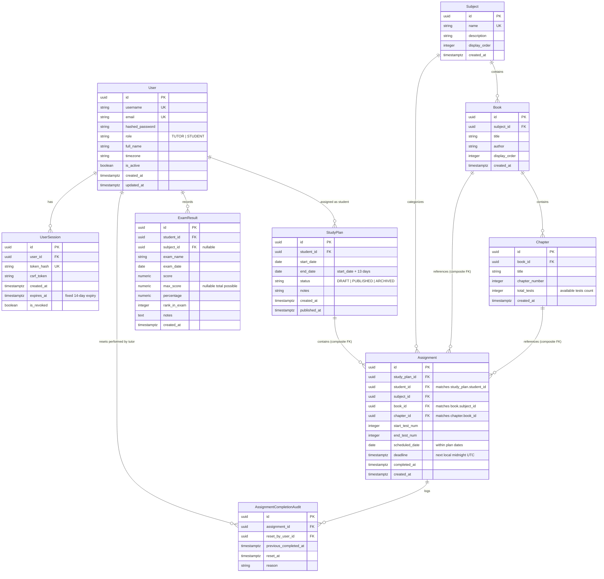

# Database Design: Academic Planner

## 1. Schema Overview

The database design adheres to clean 3NF relational modeling. All primary keys are UUIDs (or auto-incrementing integers where compact performance is preferred; UUIDv7 / UUIDv4 recommended for non-enumerable IDs). All timestamps are stored with timezone (`TIMESTAMPTZ` in PostgreSQL).

### Entity-Relationship Diagram



## 2. Table Specifications

### 2.1 `users`
Represents both the tutor and students.
- `id` (UUID, PK, default: `gen_random_uuid()`): Unique identifier.
- `username` (VARCHAR(50), UNIQUE, NOT NULL): Login handle.
- `email` (VARCHAR(255), UNIQUE, NULLABLE): Optional contact email.
- `hashed_password` (VARCHAR(255), NOT NULL): Password hash (Argon2id or bcrypt).
- `role` (VARCHAR(20), NOT NULL): Enum-like check (`'TUTOR'`, `'STUDENT'`).
- `full_name` (VARCHAR(100), NOT NULL): Display name.
- `timezone` (VARCHAR(50), NOT NULL, default: `'UTC'`): User's local timezone (e.g., `'Asia/Tehran'`, `'Europe/London'`).
- `is_active` (BOOLEAN, NOT NULL, default: `TRUE`): Allows immediate account suspension.
- `created_at` (TIMESTAMPTZ, NOT NULL, default: `NOW()`).
- `updated_at` (TIMESTAMPTZ, NOT NULL, default: `NOW()`).
*Indexes*:
- `ix_users_username` (Unique)
- `ix_users_role` (Filtered for rapid student listing)

### 2.2 `user_sessions`
Server-side active login sessions with fixed expiration and anti-CSRF binding.
- `id` (UUID, PK, default: `gen_random_uuid()`).
- `user_id` (UUID, FK -> `users.id`, ON DELETE CASCADE, NOT NULL).
- `token_hash` (VARCHAR(64), UNIQUE, NOT NULL): SHA-256 hash of random session token string.
- `csrf_token` (VARCHAR(64), NOT NULL): Cryptographically secure random anti-CSRF token.
- `expires_at` (TIMESTAMPTZ, NOT NULL): Fixed expiration timestamp (exactly 14 days from creation; non-rolling to prevent session immortality).
- `is_revoked` (BOOLEAN, NOT NULL, default: `FALSE`).
- `created_at` (TIMESTAMPTZ, NOT NULL, default: `NOW()`).
*Indexes*:
- `ix_user_sessions_token_hash` (Unique, fast lookup on every authenticated request)
- `ix_user_sessions_user_id` (Quick lookup for session revocation)

### 2.3 `subjects`
Top-level curriculum categories.
- `id` (UUID, PK, default: `gen_random_uuid()`).
- `name` (VARCHAR(100), UNIQUE, NOT NULL): E.g., "Mathematics", "Physics".
- `description` (TEXT, NULLABLE).
- `display_order` (INTEGER, NOT NULL, default: `0`).
- `created_at` (TIMESTAMPTZ, NOT NULL, default: `NOW()`).

### 2.4 `books`
Textbooks or material resources grouped under a subject.
- `id` (UUID, PK, default: `gen_random_uuid()`).
- `subject_id` (UUID, FK -> `subjects.id`, ON DELETE RESTRICT, NOT NULL).
- `title` (VARCHAR(150), NOT NULL): E.g., "Calculus: Early Transcendentals".
- `author` (VARCHAR(100), NULLABLE).
- `display_order` (INTEGER, NOT NULL, default: `0`).
- `created_at` (TIMESTAMPTZ, NOT NULL, default: `NOW()`).
*Constraints & Indexes*:
- `ix_books_subject_id`
- `uq_books_id_subject` UNIQUE(`id`, `subject_id`) (Required for assignment composite FK)

### 2.5 `chapters`
Individual chapters within a book.
- `id` (UUID, PK, default: `gen_random_uuid()`).
- `book_id` (UUID, FK -> `books.id`, ON DELETE RESTRICT, NOT NULL).
- `title` (VARCHAR(150), NOT NULL): E.g., "Limits and Continuity".
- `chapter_number` (INTEGER, NOT NULL): Order within book.
- `total_tests` (INTEGER, NOT NULL): Available test/exercise count, constrained to `total_tests >= 1`.
- `created_at` (TIMESTAMPTZ, NOT NULL, default: `NOW()`).
*Constraints & Indexes*:
- `ix_chapters_book_id`
- `uq_chapters_book_number` UNIQUE(`book_id`, `chapter_number`)
- `uq_chapters_id_book` UNIQUE(`id`, `book_id`) (Required for assignment composite FK)
- `ck_chapters_total_tests_positive` CHECK(`total_tests >= 1`)

### 2.6 `study_plans`
14-day study plans created by the tutor for a specific student.
- `id` (UUID, PK, default: `gen_random_uuid()`).
- `student_id` (UUID, FK -> `users.id`, ON DELETE CASCADE, NOT NULL).
- `start_date` (DATE, NOT NULL): First day of the plan.
- `end_date` (DATE, NOT NULL): Last day of the plan (must equal `start_date + 13 days`).
- `status` (VARCHAR(20), NOT NULL, default: `'DRAFT'`): Enum check `'DRAFT'`, `'PUBLISHED'`, `'ARCHIVED'`.
- `notes` (TEXT, NULLABLE): Tutor guidance or objectives.
- `created_at` (TIMESTAMPTZ, NOT NULL, default: `NOW()`).
- `published_at` (TIMESTAMPTZ, NULLABLE).
*Constraints & Indexes*:
- `ck_study_plans_exact_14_days` CHECK(`end_date = start_date + INTERVAL '13 days'`)
- `uq_study_plans_id_student` UNIQUE(`id`, `student_id`) (Enables composite FK from assignments)
- `uq_study_plans_one_published_per_student` UNIQUE(`student_id`) WHERE (`status = 'PUBLISHED'`) (Partial unique index enforcing exactly one active published plan per student)
- `ix_study_plans_student_status` (`student_id`, `status`)

### 2.7 `assignments`
Specific study tasks scheduled on individual dates.
- `id` (UUID, PK, default: `gen_random_uuid()`).
- `study_plan_id` (UUID, NOT NULL).
- `student_id` (UUID, NOT NULL).
- `subject_id` (UUID, NOT NULL).
- `book_id` (UUID, NOT NULL).
- `chapter_id` (UUID, NOT NULL).
- `start_test_num` (INTEGER, NOT NULL): First test number.
- `end_test_num` (INTEGER, NOT NULL): Last test number.
- `scheduled_date` (DATE, NOT NULL): Must fall within `[study_plan.start_date, study_plan.end_date]`.
- `deadline` (TIMESTAMPTZ, NOT NULL): Next local midnight in UTC (`scheduled_date + 1 day at 00:00:00` local).
- `completed_at` (TIMESTAMPTZ, NULLABLE): Recorded server timestamp when completed.
- `created_at` (TIMESTAMPTZ, NOT NULL, default: `NOW()`).
*Foreign Keys, Constraints & Indexes*:
- Composite FK 1: `FOREIGN KEY (study_plan_id, student_id) REFERENCES study_plans(id, student_id) ON DELETE CASCADE` (Mathematically guarantees an assignment cannot reference a student different from the plan owner).
- Composite FK 2: `FOREIGN KEY (book_id, subject_id) REFERENCES books(id, subject_id) ON DELETE RESTRICT` (Guarantees book belongs to selected subject).
- Composite FK 3: `FOREIGN KEY (chapter_id, book_id) REFERENCES chapters(id, book_id) ON DELETE RESTRICT` (Guarantees chapter belongs to selected book).
- `ck_assignments_test_range` CHECK(`start_test_num >= 1 AND end_test_num >= start_test_num`)
- `ix_assignments_student_scheduled` (`student_id`, `scheduled_date`)
- `ix_assignments_plan_id` (`study_plan_id`)
- `ix_assignments_student_deadline` (`student_id`, `deadline`, `completed_at`)

### 2.8 `assignment_completion_audits`
Immutable audit log tracking all tutor resets of completed assignments.
- `id` (UUID, PK, default: `gen_random_uuid()`).
- `assignment_id` (UUID, FK -> `assignments.id`, ON DELETE CASCADE, NOT NULL).
- `reset_by_user_id` (UUID, FK -> `users.id`, ON DELETE RESTRICT, NOT NULL): The tutor who performed the reset.
- `previous_completed_at` (TIMESTAMPTZ, NOT NULL): The timestamp that was cleared.
- `reset_at` (TIMESTAMPTZ, NOT NULL, default: `NOW()`).
- `reason` (VARCHAR(255), NULLABLE): Explanation for the administrative reset.
*Indexes*:
- `ix_audits_assignment_id` (`assignment_id`)
- `ix_audits_reset_at` (`reset_at` DESC)

### 2.9 `exam_results`
Self-reported external examination outcomes recorded by students.
- `id` (UUID, PK, default: `gen_random_uuid()`).
- `student_id` (UUID, FK -> `users.id`, ON DELETE CASCADE, NOT NULL).
- `subject_id` (UUID, FK -> `subjects.id`, ON DELETE SET NULL, NULLABLE).
- `exam_name` (VARCHAR(150), NOT NULL): Name of the external test.
- `exam_date` (DATE, NOT NULL): Date exam was taken.
- `score` (NUMERIC(6, 2), NOT NULL): Raw score achieved (`score >= 0.00`).
- `max_score` (NUMERIC(6, 2), NULLABLE): Total possible score if applicable (`max_score > 0.00`).
- `percentage` (NUMERIC(5, 2), NOT NULL): Percentage representation (0.00 to 100.00).
- `rank_in_exam` (INTEGER, NOT NULL): Rank attained within that exam sitting (`rank_in_exam >= 1`).
- `notes` (TEXT, NULLABLE): Student reflections or observations.
- `created_at` (TIMESTAMPTZ, NOT NULL, default: `NOW()`).
*Constraints & Indexes*:
- `ck_exam_percentage` CHECK(`percentage >= 0.00 AND percentage <= 100.00`)
- `ck_exam_score_non_negative` CHECK(`score >= 0.00`)
- `ck_exam_score_max_score` CHECK(`max_score IS NULL OR (max_score > 0.00 AND score <= max_score)`)
- `ck_exam_rank` CHECK(`rank_in_exam >= 1`)
- `ix_exam_results_student_date` (`student_id`, `exam_date` DESC)

## 3. Business Logic & Query Design

### 3.1 Status Derivation in SQL
To eliminate state desynchronization, assignment completion status is calculated on-the-fly in queries or exposed as a generated expression with exclusive cutoff `< deadline`:

```sql
CASE
    WHEN completed_at IS NOT NULL AND completed_at < deadline THEN 'COMPLETED_ON_TIME'
    WHEN completed_at IS NOT NULL AND completed_at >= deadline THEN 'COMPLETED_LATE'
    WHEN completed_at IS NULL AND NOW() >= deadline THEN 'OVERDUE'
    ELSE 'PENDING'
END AS derived_status
```

### 3.2 Timezone & Deadline Boundary Strategy
1. **Database Storage**: All datetime columns (`deadline`, `completed_at`, `created_at`, `expires_at`, `reset_at`) use PostgreSQL `TIMESTAMPTZ` and are stored in UTC.
2. **Next Local Midnight as Exclusive Cutoff**:
   - For an assignment scheduled on calendar date `D`, the end-of-day deadline is defined as the next local midnight:
     `D + 1 day at 00:00:00.000` in the student's designated timezone, converted to UTC `TIMESTAMPTZ`.
   - On-time completion is strictly exclusive: `completed_at < deadline`.
   - Any completion at or after the next local midnight (`completed_at >= deadline`) is marked `COMPLETED_LATE`.
   - This cleanly avoids sub-second precision issues (e.g. 23:59:59.999 vs 23:59:59.000).
3. **Display Rendering**: Jinja2 filters convert UTC timestamps to the user's localized timezone string for dashboard presentation.

## 4. Migration & Maintenance Strategy

### Alembic Migrations
- Standard Alembic migration workflow (`alembic revision --autogenerate -m "..."`).
- Migrations run automatically on container startup or via an explicit deployment command (`alembic upgrade head`).
- All constraints and indexes are explicitly named in Python models via an Alembic-friendly naming convention:
  - `ck_%(table_name)s_%(constraint_name)s`
  - `fk_%(table_name)s_%(column_0_name)s_%(referred_table_name)s`
  - `pk_%(table_name)s`
  - `uq_%(table_name)s_%(column_0_name)s`
  - `ix_%(table_name)s_%(column_0_name)s`

### Backup, Volume Mount & Restoration Runbook
- **Docker Compose Volume Configuration**:
  ```yaml
  db:
    image: postgres:16-alpine
    volumes:
      - postgres_data:/var/lib/postgresql/data
      - ./backups:/var/lib/postgresql/backups
  ```
- **Automated Backup Command**:
  ```bash
  # Ensures host directory exists with proper permissions
  mkdir -p ./backups
  # Produces compressed custom-format pg_dump
  docker compose exec -T db pg_dump -U postgres -d valhalla_db -F c -b -v -f /var/lib/postgresql/backups/valhalla_$(date +%Y%m%d_%H%M%S).dump
  ```
- **Restoration & Verification Command**:
  ```bash
  # Restore to database (cleans/replaces existing tables before restoring)
  docker compose exec -T db pg_restore -U postgres -d valhalla_db -c -v /var/lib/postgresql/backups/target_file.dump
  # Quick integrity verification check
  docker compose exec -T db psql -U postgres -d valhalla_db -c "SELECT count(*) FROM users;"
  ```
